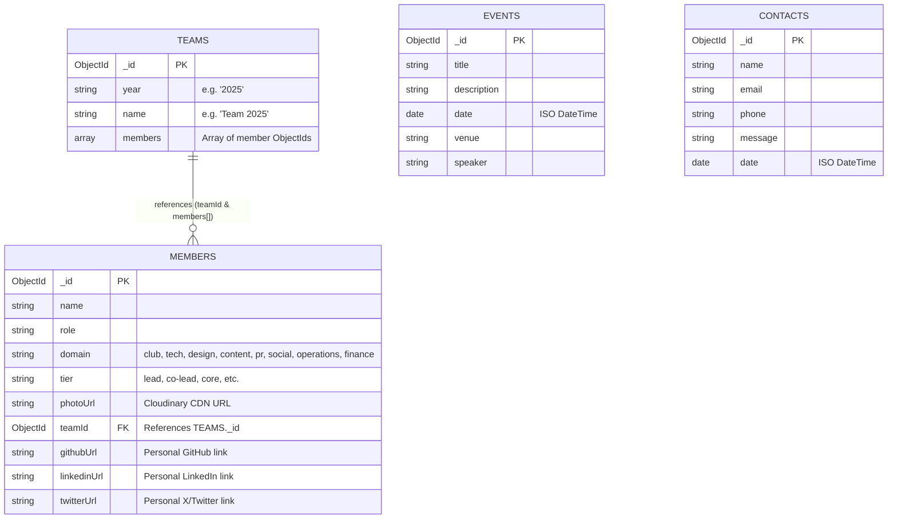

# Database Documentation: `gdg_nmit`

## 1. Overview & Connection Architecture

* **Database Name:** `gdg_nmit`
* **Cluster:** MongoDB Atlas 3-node Replica Set (`atlas-20a61o-shard-0`)
* **Host Nodes:** `ac-m5cpesg-shard-00-00.mhodsqb.mongodb.net`, `01`, `02:27017`
* **Driver:** Official MongoDB Node.js Driver (`mongodb` v6)
* **Environment Configuration:** Configured in `.env.local` via `MONGODB_URI` / `MONGO_URL`
* **Connection Pooling:** Singleton client pooling with Google DNS fallbacks (`8.8.8.8`, `1.1.1.1`) located at [`src/lib/mongodb.ts`](src/lib/mongodb.ts).

```text
mongodb://gdg_db_user:<password>@ac-m5cpesg-shard-00-00.mhodsqb.mongodb.net:27017,ac-m5cpesg-shard-00-01.mhodsqb.mongodb.net:27017,ac-m5cpesg-shard-00-02.mhodsqb.mongodb.net:27017/gdg_nmit?ssl=true&replicaSet=atlas-20a61o-shard-0&authSource=admin&retryWrites=true&w=majority
```

---

## 2. Entity-Relationship (ER) Diagram



---

## 3. Collections & Schemas

### 3.1. `teams` Collection
Stores high-level team groupings by academic/club year.

| Field | Type | Required | Description |
| :--- | :--- | :---: | :--- |
| `_id` | `ObjectId` | Yes | Primary key identifier |
| `year` | `string` | Yes | Year identifier (e.g., `"2025"`) |
| `name` | `string` | Yes | Display title (e.g., `"Team 2025"`) |
| `members` | `ObjectId[]` | Yes | Array of referenced `members._id` values |

---

### 3.2. `members` Collection
Stores individual GDG member profiles. Normalized relationship referencing `teams._id`.

| Field | Type | Required | Description |
| :--- | :--- | :---: | :--- |
| `_id` | `ObjectId` | Yes | Primary key identifier |
| `teamId` | `ObjectId` | Yes | Foreign key reference to `teams._id` |
| `name` | `string` | Yes | Full name |
| `role` | `string` | Yes | Designation (e.g., `"Lead"`, `"Co-Lead"`, `"Core"`, `"Co-organizer"`) |
| `domain` | `string` | Yes | Functional department (see Allowed Domains) |
| `tier` | `string` | Yes | Seniority / hierarchy level (see Allowed Tiers) |
| `photoUrl` | `string` | No | Cloudinary profile image CDN link |
| `githubUrl` | `string` | No | Personal GitHub profile link |
| `linkedinUrl` | `string` | No | Personal LinkedIn profile link |
| `twitterUrl` | `string` | No | Personal X / Twitter profile link |

#### Allowed Domains (8 Total):
* `club` (Heads & Advisors / Board)
* `tech` (Technical Team)
* `design` (Design Team)
* `content and documentation` (Content & Documentation)
* `pr & marketing` (PR & Marketing)
* `social media` (Social Media)
* `operations` (Operations)
* `finance` (Sponsorship & Finance) *(Newly Added)*

#### Allowed Tiers:
* `faculty coordinator`
* `lead`
* `co-lead`
* `student-advisor`
* `mentor`
* `core`
* `member`
* `past`
* `recruit`

---

### 3.3. `events` Collection
Stores club events, hackathons, and workshops.

| Field | Type | Required | Description |
| :--- | :--- | :---: | :--- |
| `_id` | `ObjectId` | Yes | Primary key identifier |
| `title` | `string` | Yes | Event title |
| `description` | `string` | Yes | Full markdown or plain text details |
| `date` | `date` / `string` | Yes | ISO DateTime timestamp |
| `venue` | `string` | Yes | Location / hall / auditorium |
| `speaker` | `string` | No | Guest speaker or host name |

---

### 3.4. `contacts` Collection
Stores inquiries and messages submitted via the Contact Us form.

| Field | Type | Required | Description |
| :--- | :--- | :---: | :--- |
| `_id` | `ObjectId` | Yes | Primary key identifier |
| `name` | `string` | Yes | Sender name |
| `email` | `string` | Yes | Sender contact email |
| `phone` | `string` | No | Sender contact phone |
| `message` | `string` | Yes | Inquired message body |
| `date` | `date` / `string` | Yes | ISO DateTime timestamp |

---

## 4. Current Ingested Data Inventory

### 4.1. `teams` Table (1 Document Ingested)

```json
{
  "_id": { "$oid": "6af2c043f79ac670f6d64f65" },
  "year": "2025",
  "name": "Team 2025",
  "members": [
    { "$oid": "6af30fcbc7b817ed54cbe4d4" },
    { "$oid": "6af2c043f79ac670f6d64f66" },
    { "$oid": "6af2c043f79ac670f6d64f67" },
    { "$oid": "6af2c043f79ac670f6d64f68" },
    { "$oid": "6af2c043f79ac670f6d64f69" },
    { "$oid": "6af2c043f79ac670f6d64f6a" },
    { "$oid": "6af2c043f79ac670f6d64f6b" },
    { "$oid": "6af2c043f79ac670f6d64f6c" },
    { "$oid": "6af2c043f79ac670f6d64f6d" },
    { "$oid": "6af2c043f79ac670f6d64f6e" },
    { "$oid": "6af2c043f79ac670f6d64f6f" },
    { "$oid": "6af2c043f79ac670f6d64f70" },
    { "$oid": "6af2c043f79ac670f6d64f71" },
    { "$oid": "6af2c043f79ac670f6d64f72" },
    { "$oid": "6af2c043f79ac670f6d64f73" },
    { "$oid": "6af2c043f79ac670f6d64f74" },
    { "$oid": "6af316ca12bd34f901a779d1" },
    { "$oid": "6af316ca12bd34f901a779d2" },
    { "$oid": "6af316ca12bd34f901a779d3" }
  ]
}
```

---

### 4.2. `members` Table (19 Members Ingested)

Source: Google Sheet `Core Member Details` + Faculty Advisor (Ingested: 19 Members / 1 Faculty Advisor + 18 Core Members).

| # | Member `_id` | Name | Domain | Role | Tier | Social Profiles |
| :---: | :--- | :--- | :--- | :--- | :---: | :--- |
| **1** | `6af30fcbc7b817ed54cbe4d4` | **Mohan Kumar TG** | `club` | GDG Faculty Advisor | `faculty coordinator` | [LinkedIn](https://www.linkedin.com/in/mohankumartg/) |
| **2** | `6af2c043f79ac670f6d64f6d` | **Aaditya A Wol** | `club` | Co-organizer | `co-lead` | [GitHub](https://github.com/aadiwol) • [LinkedIn](https://www.linkedin.com/in/aadityawol) |
| **3** | `6af2c043f79ac670f6d64f71` | **Surendra Tripathi** | `club` | Co-Organizer | `co-lead` | [GitHub](https://www.github.com/Surendra-T) • [LinkedIn](https://www.linkedin.com/in/tripathisurendra) • [X](https://x.com/Surendra_trips) |
| **4** | `6af316ca12bd34f901a779d1` | **Swati Jambagi** | `club` | Co organiser | `co-lead` | [GitHub](https://github.com/SwathiJambagi) • [LinkedIn](https://www.linkedin.com/in/swati-jambagi-062291331/) |
| **5** | `6af2c043f79ac670f6d64f6b` | **Srujan S** | `tech` | Lead | `lead` | [GitHub](https://github.com/srujan-s22) • [LinkedIn](https://www.linkedin.com/in/srujan-s22) |
| **6** | `6af2c043f79ac670f6d64f66` | **Shreyas Rajashekar** | `tech` | Co-Lead | `co-lead` | [GitHub](https://github.com/shreyasrajshekar) • [LinkedIn](https://linkedin.com/in/shreyas-rajashekar-me/) • [X](https://x.com/FIREgangsterZ) |
| **7** | `6af2c043f79ac670f6d64f69` | **Vennela S Shetty** | `tech` | Core | `core` | [GitHub](https://github.com/VennelaSshetty) • [LinkedIn](https://www.linkedin.com/in/vennela-s-shetty-467984336/) |
| **8** | `6af2c043f79ac670f6d64f67` | **Devanshu Puri** | `design` | Lead | `lead` | [GitHub](https://github.com/devanshu-puri) • [LinkedIn](https://www.linkedin.com/in/devanshu-puri-77b68a303) • [X](https://x.com/DEVANSHUPUR1) |
| **9** | `6af2c043f79ac670f6d64f73` | **Ayush V Upadhya** | `design` | Co-Lead | `co-lead` | [GitHub](https://github.com/ayushvupadhya) • [LinkedIn](https://www.linkedin.com/in/ayush-v-upadhya-970483367/) • [X](https://x.com/ayushvupadhya) |
| **10** | `6af2c043f79ac670f6d64f74` | **Niharika Jonnakuti** | `design` | Co-Lead | `co-lead` | [GitHub](https://github.com/niharikajonnakuti-lang) • [LinkedIn](https://www.linkedin.com/in/niharika-jonnakuti-041611369) |
| **11** | `6af316ca12bd34f901a779d2` | **Rahul Nath** | `content and documentation` | Lead | `lead` | [GitHub](https://github.com/masterrahulnath) • [LinkedIn](https://www.linkedin.com/in/rahul-nath-56b993328/) |
| **12** | `6af2c043f79ac670f6d64f72` | **Sakshi Swamy Patil** | `content and documentation` | Co lead | `co-lead` | [GitHub](https://github.com/swampmarshy) |
| **13** | `6af2c043f79ac670f6d64f6a` | **Hari** | `content and documentation` | Core | `core` | [GitHub](https://github.com/harii88) • [LinkedIn](https://www.linkedin.com/in/harivadhanasan) |
| **14** | `6af2c043f79ac670f6d64f70` | **Devisha Srivastava** | `content and documentation` | Core | `core` | [GitHub](https://github.com/devishacodes) • [LinkedIn](https://www.linkedin.com/in/devisha-srivastava-1711a9360) |
| **15** | `6af2c043f79ac670f6d64f68` | **Oshika Tiwari** | `pr & marketing` | Co-Lead | `co-lead` | [GitHub](https://github.com/oshikatiwari) • [LinkedIn](https://www.linkedin.com/in/oshika-tiwari-76b110388) • [X](https://x.com/OshikaTiwari) |
| **16** | `6af2c043f79ac670f6d64f6c` | **K S Tanisha** | `pr & marketing` | Co-Lead | `co-lead` | [GitHub](https://github.com/kstanisha) • [LinkedIn](https://www.linkedin.com/in/k-s-tanisha-1b1950386) |
| **17** | `6af2c043f79ac670f6d64f6e` | **Akash** | `social media` | Lead | `lead` | [GitHub](https://github.com/AkashHQ) • [LinkedIn](https://www.linkedin.com/in/akash-polakpalli-79341036a) • [X](https://x.com/akashpolakpalli) |
| **18** | `6af2c043f79ac670f6d64f6f` | **Sheikh Mueez** | `social media` | CORE | `core` | [GitHub](https://github.com/Mueez413) • [LinkedIn](https://www.linkedin.com/in/mzz13) |
| **19** | `6af316ca12bd34f901a779d3` | **Akshita Sohaney** | `social media` | Social Media Core | `core` | [GitHub](https://github.com/akshitasohaney) • [LinkedIn](https://www.linkedin.com/in/akshita-sohaney-724841312) |

* **Pending Members:** 3 core members are yet to submit details on the Google Sheet.

---

### 4.3. `events` Table (0 Documents Ingested)
* **Status:** Clean & empty.
* **Ready for:** Workshop, Hackathon, and Event records via `POST /api/events` or direct insertion.

---

### 4.4. `contacts` Table (0 Documents Ingested)
* **Status:** Clean & empty.
* **Ready for:** Messages submitted via the `/contact` form route (`POST /api/contact`).

---

## 5. Indexes in `gdg_nmit`

All collections include primary `_id_` indexes and support compound indexing:

1. **`teams` Collection:**
   * `{ _id: 1 }` (Primary Key)
   * Recommended: `{ year: 1 }` (Unique)
2. **`members` Collection:**
   * `{ _id: 1 }` (Primary Key)
   * Recommended: `{ teamId: 1, domain: 1 }` (Accelerates domain group filtering)
3. **`events` Collection:**
   * `{ _id: 1 }` (Primary Key)
   * Recommended: `{ date: 1 }` (Accelerates upcoming event ordering)
4. **`contacts` Collection:**
   * `{ _id: 1 }` (Primary Key)
   * Recommended: `{ date: -1 }` (Accelerates admin view chronologically)

